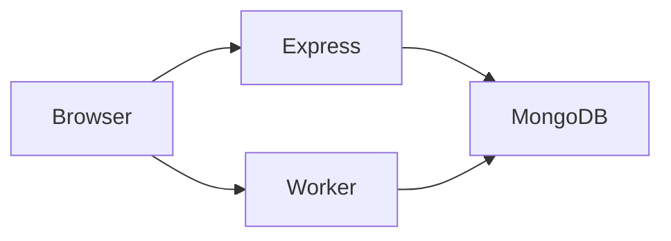

> **UNINITIALIZED.** Do not treat this file as project truth until Memory Initialization Agent has run and GM0 is approved. Template structure only.
# Architecture

**Last updated:** YYYY-MM-DD

## High-level diagram

Describe components in text or mermaid. Keep it current.

## Components

| Component | Path | Responsibility |
|---|---|---|

## Request flow

1.
2.

## Data stores

| Store | Owner module | Notes |
|---|---|---|

## Dual runtime

Express and Worker must stay behavior-identical. Details: [runtime-parity.md](../runtime-parity.md).

## Boundaries agents must respect

-

## Related decisions

- decisions/
