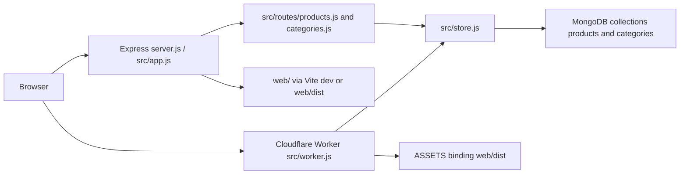

# Architecture

**Last updated:** 2026-11-02

## High-level diagram

## Components

| Component | Path | Responsibility |
|---|---|---|
| Local process | `server.js` | Loads `.env` via `loadLocalEnv()`, builds the Express app, listens on `PORT` or 3000. |
| Express app | `src/app.js` | JSON body parser, `/api/*` routers, API error JSON, Vite middleware in `--dev`, static `web/dist` otherwise, page routes. |
| Express adapters | `src/routes/products.js`, `src/routes/categories.js` | Map HTTP to `src/store.js` using `localEnv()`. |
| Async wrapper | `src/asyncRoute.js` | Forwards rejected Express handlers to error middleware. |
| Local env | `src/env.js` | Parses `.env` without overriding existing process env. Exposes `MONGODB_URI` and `MONGODB_DB`. |
| Worker entry | `src/worker.js` | Same API verbs and JSON shapes. `GET /` redirects. Other non-API requests go to `env.ASSETS.fetch`. |
| Store | `src/store.js` | Validation, seeding, indexes, Mongo access. Shared by both runtimes. |
| Web shell | `web/src/main.jsx`, `web/src/App.jsx` | React 19, React Router 7, nav, titles, routes. |
| Dashboard | `web/src/components/Dashboard.jsx`, `FilterPanel.jsx`, `ProductPanel.jsx`, `catalogView.js` | Client-side filter, sort, chips, featured tile, session heart. |
| Admin pages | `web/src/components/Products.jsx`, `Categories.jsx` | Inline CRUD and the products cart. |
| HTTP helper | `web/src/api.js` | `fetch` JSON; throws `Error` with `body.error`. |
| Web build | `scripts/build-web.mjs`, `web/vite.config.js` | Vite build of `web/` into `web/dist`. Wrangler build command calls the script. |
| Node switch | `scripts/with-node.cmd` | `nvm use 22` before Wrangler scripts on Windows. |

## Request flow

1. Browser loads a page route. Express either transforms `web/index.html` with Vite (`npm run dev`) or sends `web/dist/index.html`. The Worker serves built assets unless the path is `/` or `/api` / `/api/*` (`run_worker_first` in `wrangler.toml`).
2. `App.jsx` sets `document.title` from the path (`Dashboard`, `Products`, `Categories`; anything else stays `Dashboard`) and renders the matching page. The static `web/index.html` title is `Products` until React runs.
3. Pages call same-origin `/api/products` and `/api/categories`.
4. Express routers call store functions with `localEnv()`. The Worker calls the same functions with the Worker `env`.
5. `withDatabase` opens a new `MongoClient`, ensures the category-name index and the empty-catalog seed, runs the operation, then `close(true)`.
6. Store errors carry `error.status`. API layers return `{ "error": message }`. Status 500 is replaced with `"Request failed"` unless the message is `"MONGODB_URI is not set"`.

## Data stores

| Store | Owner module | Notes |
|---|---|---|
| MongoDB database `MONGODB_DB` or `productmanage` | `src/store.js` | Collections `categories` and `products`. Documents use string `_id`. API field is `id`. |
| In-memory dashboard filters and wishlist | `web/src/components/Dashboard.jsx` | Dropped on reload. Not sent to the API. |
| In-memory product cart | `web/src/components/Products.jsx` | Dropped on reload. Not sent to the API. |
| `data/db.json` | none | Gitignored. No current source import. See known issues. |

## Dual runtime

Express and Worker must stay behavior-identical for API status codes and JSON bodies. Routing tables are duplicated: Express uses routers, the Worker uses pathname regexes. Details: [runtime-parity.md](runtime-parity.md).

## Boundaries agents must respect

- Put validation and persistence changes in `src/store.js` so both runtimes pick them up.
- Update `src/routes/*.js` and `src/worker.js` together when the HTTP surface changes.
- Page paths added in `web/src/App.jsx` also need an Express `pagePaths` entry. Worker page serving depends on the assets binding and `run_worker_first`.
- Do not write `MONGODB_URI` into `wrangler.toml`, source, or memory.
- `web/dist` is gitignored. Production and Wrangler builds produce it.

## Related decisions

- [decisions/001-dual-express-worker-runtime.md](decisions/001-dual-express-worker-runtime.md)
- [decisions/002-per-request-mongo-client.md](decisions/002-per-request-mongo-client.md)
- [decisions/003-mongodb-uri-outside-source.md](decisions/003-mongodb-uri-outside-source.md)
