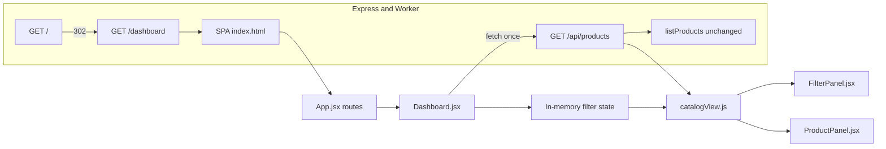

# Implementation Plan: Product Dashboard with Filter Panel and Card Grid

Status: approved on 2026-11-02. This plan is the authorized scope for the Software Developer. Do not add product fields, a cart, or behavior outside this document.

The dashboard is a new storefront view on the existing catalog. It does not add product fields, API routes, or a cart. Filter and sort behavior that the stored product documents can support runs on the client. Controls that need `stock`, `color`, `weight`, or best-seller data stay visible and do not hide products.

## Confirmed decisions

These decisions come from the human approval on `docs/workflow/requirements-analysis.md` (2026-11-02). They are requirements for this plan, not open assumptions.

| # | Decision | Technical consequence |
|---|---|---|
| 1 | Add a Dashboard page at `/dashboard` and make it the landing page. Keep the Products and Categories admin pages. | New React route, nav item, Express page path, and `/` redirect. `/products` and `/categories` stay. |
| 2 | Show every filter from the screenshot. Apply price sort and newest sort to stored data. Treat current products as in stock. Leave color, weight, and best-seller controls visible without hiding products until those fields exist. | All six sort radios, the availability toggle, five price checkboxes, and eight swatches render. Only price-range membership and `createdAt` / `price` ordering change which products appear and in what order. |
| 3 | Use a placeholder when a product has no image. Do not add an image field in this pass. | Static placeholder artwork in the card and featured tile. No `image` / `imageUrl` on the store or API. |
| 4 | Render the first matching product as the large featured tile. | After filter and sort, `items[0]` uses the featured layout. The remaining items use standard cards. |
| 5 | Show BUY NOW and the heart as visible controls. Do not build a cart in this pass. | Real buttons on standard cards. No cart module, drawer, persistence, or API write. |
| 6 | Price counts are totals for the whole loaded catalog, not counts after other filters. | Bucket counts are computed from the fetched array and ignore sort, availability, color, and selected price ranges. |

## Proposed design

### Page chrome

`/` redirects to `/dashboard` with HTTP 302 on both Express and the Worker. The React app also sends `/` and any unknown client path to `/dashboard`.

The top navigation becomes **Dashboard**, **Products**, **Categories**, in that order. Dashboard is a `NavLink` to `/dashboard`. Products and Categories keep their current admin screens.

Admin routes keep the current header, title, max width (`1100px`), and `#eef2f5` page background. The dashboard route does not render that admin `<h1>`. It sets `document.title` to `Dashboard` and uses a full-width white page so the storefront is not clipped by `.page`.

A compact nav remains above the storefront so the admin pages stay reachable. The reference screenshot has no admin chrome; this bar is the minimum addition required by decision 1.

### Two-column storefront

Under the nav, the dashboard is a horizontal pair:

- Left: filter panel, about 240px wide, with a right border as the vertical divider and a top border between sections.
- Right: product panel. The header shows `<N> items` and removable chips. The body is the card grid.

The result text always uses the word `items`, including `0 items` and `1 items`, matching the `<N> items` acceptance format.

Breakpoints:

| Viewport | Layout |
|---|---|
| `>= 1280px` | Sidebar and product panel side by side. Product grid is 5 columns. |
| `960px–1279px` | Side by side. Product grid is 3 columns. |
| `640px–959px` | Filter panel stacks above the product panel. Product grid is 2 columns. |
| `< 640px` | Stacked. Product grid is 1 column. |

Grid cells use `minmax(0, 1fr)` so cards shrink instead of overflowing. The featured tile occupies the first cell only. It does not span multiple columns. It is taller than a standard card. Grid alignment is `start` so the taller tile does not stretch the other cards in the row.

### Visual tokens

Scope every new rule under `.page-dashboard` and `.dashboard` so admin styles stay as they are. The global `button { padding: 0 16px 4px; }` rule must be reset on dashboard controls.

| Element | Treatment |
|---|---|
| Page background | `#ffffff` |
| Standard image well | `#f5f5f5`, square (`aspect-ratio: 1 / 1`) |
| Featured image well | `#f5f5f5`, taller (`aspect-ratio: 3 / 4`) |
| Featured caption | `#000000` background, `#ffffff` text, uppercase |
| BUY NOW | Full width, `#000000` background, `#ffffff` uppercase label, no admin pill radius |
| Active availability control | Dark `#000000` border |
| Dividers | `1px solid #e6e6e6` |
| Type | Existing `Segoe UI` stack. Collection line and featured caption are uppercase. Model name is bold. |

The reference PNG named in the requirements analysis is not in this repository. Implement the structure, labels, palette, and breakpoints in this plan. Do not block on pixel comparison with a file that is not checked in.

### Filter state

Dashboard owns one in-memory state object. Filter changes do not write the URL, `localStorage`, or the API. A reload clears them.

```text
{
  sort: "newest",
  inStockOnly: false,
  priceRangeIds: [],
  colorIds: [],
  collapsed: { availability: false, price: false, color: false }
}
```

`collapsed: false` means the section is expanded. Availability, Price, and Color render a header button that shows `−` when expanded and `+` when collapsed, with `aria-expanded` and `aria-controls`. Collapsing hides that section's controls with the `hidden` attribute and does not clear selections. The Sort section is not collapsible.

Initial sort is `newest`. That is the sort backed by stored `createdAt`, and it matches the order `listProducts` already returns. Best Sellers is the first radio in the list, and it is not the default, because the catalog has no best-seller field.

### Sort

Radios are one group of six, in this order and with these labels:

| Radio label | State id | Order |
|---|---|---|
| `Best Sellers` | `best-sellers` | Keep the fetched array order. Do not hide products. |
| `Newest` | `newest` | `createdAt` descending. Missing or unparseable timestamps sort last. |
| `Price:High-Low` | `price-desc` | `price` descending. |
| `Price:Low-High` | `price-asc` | `price` ascending. |
| `Weight:Heavy-Light` | `weight-desc` | Keep the fetched array order. Do not hide products. |
| `Weight:Light-Heavy` | `weight-asc` | Keep the fetched array order. Do not hide products. |

Price and newest comparisons break ties by `id` ascending so equal seed timestamps (all three seed products share one `createdAt`) have a stable order. Non-finite prices sort last on both price sorts. Do not invent sales rank or weight.

Switching from a price sort to Best Sellers or either Weight option restores the fetched order. It does not leave the previous price order in place. Copy the fetched array before sorting. Never sort it in place.

### Availability

The Availability section contains one toggle button labeled `In Stock Only`. When pressed, it sets `aria-pressed="true"`, draws the dark border, and adds an `In Stock Only` chip.

This pass treats every loaded product as in stock. Turning the toggle on does not remove products. The predicate is a single function, `productIsInStock`, that returns `true`. Do not read a stock field and do not add one.

### Price ranges

Five checkboxes. A product matches a selected set when its price is in any selected range (OR). With none selected, price does not exclude products.

| Label | Id | Interval |
|---|---|---|
| `below $100` | `below-100` | `0 <= price < 100` |
| `$100 to $199` | `100-199` | `100 <= price < 200` |
| `$200 to $299` | `200-299` | `200 <= price < 300` |
| `$300 to $399` | `300-399` | `300 <= price < 400` |
| `$400 and up` | `400-up` | `price >= 400` |

Intervals are half-open except the open-ended top bucket, so a price cannot fall into two buckets. `$100.00` is `$100 to $199`, not `below $100`. The store already rounds prices to two decimals; the client still uses these numeric bounds rather than a `<= 199.99` comparison.

Each row shows the catalog count for that bucket, right-aligned. Counts come from the full fetched list. Selecting In Stock Only, a color, or a price range does not change the numbers. The seed catalog (Wireless Mouse `$24.50`, Field Guide `$18.00`, Desk Lamp `$39.00`) counts as `3, 0, 0, 0, 0`.

A non-finite or negative price matches no bucket. It stays visible when no price checkbox is selected, and it drops out when any price checkbox is selected.

### Color

Eight swatches, 4 columns by 2 rows, in this order: `Black`, `White`, `Gold`, `Silver`, `Red`, `Blue/Navy`, `Green`, `Yellow`. Each swatch is a toggle button with the visible label under the tile and `aria-pressed` reflecting selection.

Suggested swatch fills, used only as CSS: `#111111`, `#ffffff` (with a border so it is visible), `#c5a35a`, `#c0c0c0`, `#c62828`, `#1a2744`, `#2e7d32`, `#f5d90a`.

Selecting any number of colors records them for chips and does not remove products. `matchesColor` returns `true` for every product in this pass. Do not infer color from the product name.

### Chips

The product header renders one chip per active availability toggle, selected price range, and selected color. Sort does not create a chip. Order:

1. `In Stock Only` when that toggle is on.
2. Selected price ranges in the checkbox order above.
3. Selected colors in the swatch order above.

Each chip is a button whose accessible name is `Remove <label>`. The visible text is `<label> ×`. Activating it clears that one filter and leaves the others. The grid, result count, and that control's pressed state update together. Chip removal does not refetch.

### Featured tile and standard cards

`viewCatalog` returns the filtered, sorted list. `count` is that list's length and includes the featured product. `featured` is the first item, or `null` when the list is empty. `cards` is the rest.

Featured tile:

- Placeholder in the tall image well.
- Black caption. First line: `categoryName` in uppercase, omitted when the name is empty. Second line: `name`.
- No price, no heart, and no BUY NOW. Decision 4 selects the featured caption style, not a featured purchase card.

Standard card, for every later item:

- Gray image well, centered placeholder, heart button in the top-right of the well.
- Collection line: `categoryName` (uppercase through CSS).
- Model line: `name`, bold.
- Price: `$` plus two decimals (`$24.50`). Use `Number(price).toFixed(2)`.
- Full-width `BUY NOW` button with an inline cart/bag icon.

Do not show `sku` or `description` on the card. Acceptance requires `categoryName`, `name`, and the formatted price. `sku` stays on the admin table.

Text fields render as React text. Do not use `dangerouslySetInnerHTML`.

### Placeholder

One presentational component, used by the featured tile and every standard card, draws a static inline SVG (a simple centered product mark). It is decorative (`aria-hidden="true"`). It is not loaded from the network and is not stored on the product. Every current and newly created product uses it, because this pass adds no image field.

### BUY NOW and the heart

Both are `type="button"` elements, keyboard operable, with an accessible name that includes the product name (`Buy Desk Lamp now`, `Save Desk Lamp` / `Remove Desk Lamp from wishlist`).

The heart toggles `aria-pressed` for that product id in React state on the dashboard. The icon switches between outline and filled. The set lives only in that component. Navigation, reload, and unmount drop it. The click does not call `fetch`.

BUY NOW does not navigate, submit, call `fetch`, change the product list, or open a cart. It exists as the labeled control from decision 5.

The featured tile has neither control.

### Loading, empty, and error

Fetch state is `loading`, `ready`, or `error`.

| State | Product panel | Filter panel |
|---|---|---|
| `loading` | `Loading products…` | Renders immediately. Counts are 0 until the response arrives. Do not show `No products yet.` during the request. |
| `error` | `<p class="message error">` with the error text from `requestJson`, same pattern as `Products.jsx` | Stays visible. |
| `ready` and the fetched list is empty | `No products yet.` | Counts are 0. |
| `ready` and filters exclude every product | `No products match the selected filters.` and `0 items` | Counts still reflect the full fetched catalog. |

A failed load must not be mistaken for an empty filter result. The dashboard calls `GET /api/products` only. `categoryName` is already on each product, so it does not call `GET /api/categories`.

Ignore a stale response when the component unmounts, using the same cancelled-flag pattern as `Products.jsx`.

### Behavior this pass leaves unchanged

- Product and category documents, validation, seed data, and API shapes.
- Admin create, edit, and delete on `/products` and `/categories`.
- `GET /api/products` and `GET /api/categories` request and response contracts.
- MongoDB connection requirements. A missing `MONGODB_URI` still surfaces as the existing API error string, shown in the dashboard error paragraph.

## Architecture and data-flow changes



The server learns one new HTML path and a new redirect target. It does not learn new query parameters or product fields. Filtering is a pure function of the fetched array plus UI state:

1. On mount, `Dashboard` fetches `{ items }` from `GET /api/products`.
2. `countPriceRanges(items)` fills the five checkbox counts from that full array.
3. `filterProducts` applies the price-range OR. Availability and color predicates return true for every product.
4. `sortProducts` applies newest or price order, or copies the fetched order for Best Sellers and Weight.
5. The header count and grid render that result. The first row of the result is the featured tile.

No React context, reducer library, or URL sync. Lifting state to `Dashboard` and keeping the math in `catalogView.js` is enough. UI components must not reimplement bucket boundaries.

`listProducts` already sorts by `createdAt` descending. The client still sorts explicitly so the grid does not depend on that server order remaining stable.

Worker static assets already use `not_found_handling = "single-page-application"`. A direct `GET /dashboard` is not a file in `web/dist`, so the asset binding serves `index.html`. Do not add `/dashboard` to `run_worker_first`. That list is only for routes the Worker itself must answer (`/`, `/api`, `/api/*`). Express has no SPA fallback, so `/dashboard` must be added to `pagePaths` or a direct load will not serve the app.

## Files and modules expected to change

The developer may create or edit the files below. Paths are relative to the repository root.

| File | Change |
|---|---|
| `web/src/catalogView.js` | New. Pure constants and functions: sort ids, price ranges, colors, `productIsInStock`, `matchesColor`, `countPriceRanges`, `filterProducts`, `sortProducts`, `activeChips`, `viewCatalog`, and price formatting. No React. |
| `web/src/catalogView.test.js` | New. `node:test` coverage of the behaviors in the test strategy. |
| `web/src/components/Dashboard.jsx` | New. Fetch, status, filter state, heart set, composition of the two panels. |
| `web/src/components/FilterPanel.jsx` | New. Sort, Availability, Price, Color. Controlled by props. |
| `web/src/components/ProductPanel.jsx` | New. Result count, chips, featured tile, standard cards, placeholder, empty and error copy. Featured tile and card can be functions in this file. |
| `web/src/App.jsx` | Add the Dashboard route and nav item, point `/` and `*` at `/dashboard`, set the dashboard title, and apply `page page-dashboard` only on that route. |
| `web/src/index.css` | Append scoped dashboard rules. Do not restyle admin classes. |
| `src/app.js` | Add `/dashboard` to `pagePaths`. Redirect `/` to `/dashboard`. |
| `src/worker.js` | Redirect `GET /` to `/dashboard`. |
| `package.json` | Add `"test": "node --test web/src/catalogView.test.js"`. |
| `README.md` | Document `GET /` → `/dashboard` and `GET /dashboard`. Leave the API table as it is. |

Do not modify:

| File | Reason |
|---|---|
| `src/store.js` | No schema, seed, or serialization change. |
| `src/routes/products.js`, `src/routes/categories.js` | API contract stays. |
| `web/src/components/Products.jsx`, `web/src/components/Categories.jsx` | Admin CRUD stays. Duplicate the two-decimal currency helper in `catalogView.js` instead of refactoring the admin table. |
| `wrangler.toml` | Existing SPA fallback already serves `/dashboard`. |
| `.env`, `.dev.vars`, `wrangler.toml` secrets | Out of scope. Never commit credentials. |

`viewCatalog(products, state)` returns:

```text
{
  items,          // filtered then sorted; featured product included
  featured,       // items[0] or null
  cards,          // items.slice(1)
  count,          // items.length
  priceCounts,    // totals for the full products argument, keyed by range id
  chips           // ordered chip models { key, label, kind, id? }
}
```

`count` equals `cards.length + (featured ? 1 : 0)`.

## Implementation steps

1. Add `web/src/catalogView.js` with the constants, predicates, and `viewCatalog` contract above. Keep bucket boundaries and the "do not hide" predicates in this module only.
2. Add `web/src/catalogView.test.js` and the `test` script. Run `npm test` and make the cases in the test strategy pass.
3. Add `FilterPanel.jsx`, `ProductPanel.jsx`, and `Dashboard.jsx`. Wire them to `viewCatalog`. Fetch only `/api/products`.
4. Append scoped CSS, including the global button-padding reset, the white dashboard background, the divider, the five-column grid, and the breakpoints in this plan.
5. Update `App.jsx`, `src/app.js`, and `src/worker.js` together so the browser, Express, and the Worker agree that `/dashboard` is the landing page.
6. Update the README route description and the local "Open http://localhost:3000" sentence.
7. Run `npm test` again. In the browser, walk the manual checklist below on the Express dev server. Confirm `/products` and `/categories` still load and that their layout is unchanged.
8. Do not commit, push, or open a pull request in the architect phase. The developer phase commits only if that later task explicitly says so.

## Dependencies

- Existing runtime: Node `>= 22`, React 19, React Router DOM 7 (already depended on by `web/`), Express 4, the Worker asset binding. No new npm dependency.
- Tests use the built-in `node:test` runner. The root package and `web` are both `"type": "module"`, so the test file imports `catalogView.js` with ESM.
- `GET /api/products` requires `MONGODB_URI` (local `.env`, Worker secret, or `.dev.vars`). The dashboard must render the API error when that variable is missing. It must not crash before the request.
- The first successful API call still seeds the three sample products when both collections are empty. The dashboard does not seed data itself.
- No new MongoDB index. Price and newest sorts run on the array already returned by `listProducts`.

## Security and compatibility considerations

- No new write API. BUY NOW and the heart must not `POST` or `PUT`. A reviewer can confirm that `Dashboard.jsx` imports `requestJson` only for the load, or calls `fetch` only for `GET /api/products`.
- Product `name`, `categoryName`, `description`, and `sku` are untrusted catalog text. Render them as React children. The placeholder SVG is a source constant, not a URL from the database.
- Filter state stays in memory. Do not reflect it into the query string in this pass.
- The `/` redirect target is the fixed path `/dashboard`, not user input. Keep the Worker redirect on the same origin via `new URL("/dashboard", url)`, matching the current `/products` redirect style. Express keeps `res.redirect("/dashboard")` (302).
- Adding a page path does not change CORS, cookies, or auth. The app has no login gate today; this plan does not add one.
- Express and the Worker must both redirect `/` to `/dashboard`. Updating only one of them would make local and deployed landing pages disagree.
- Admin pages share `index.css` and the nav. New selectors that are not scoped will change the admin button padding, page width, or background. That is a compatibility defect, not a dashboard feature.
- Products created in the admin form have the same shape as seeded products. They appear with the placeholder, count toward price buckets, and are treated as in stock.
- `not_found_handling = "single-page-application"` means unknown Worker paths serve the SPA. That is existing behavior. This change does not expand `run_worker_first`.

## Risks and mitigations

| Risk | Mitigation |
|---|---|
| Best Sellers, Weight, Color, and In Stock Only do not change the product set. Testers may report them as broken. | This is decision 2. The plan requires the controls, chips, and pressed state to work, and requires the unit tests to lock the "do not hide" predicates. Do not invent field values to make the controls look active. |
| The featured product is also a catalog item, so an off-by-one count is easy (`N` cards vs `N` items). | `count` includes the featured tile. Unit-test `count === cards.length + 1` when the list is non-empty. |
| Seed products share one `createdAt`, so Newest has no visible time order. | Tie-break by `id` ascending and test it. Do not encode a fake best-seller order. |
| Global CSS (`button` padding, `.page` max-width, `:root` background) clashes with the storefront, or dashboard CSS leaks into admin pages. | Scope new rules. Reset button padding under `.dashboard`. Set the white background with `body:has(.page-dashboard)`. Manually open `/products` and `/categories` after the CSS change. |
| The reference screenshot is not in the repo, so spacing can drift from the original image. | Lock labels, section order, palette, column counts, and control behavior here. Treat unspecified spacing as secondary to those rules. |
| Bookmarks to `/` currently land on the product admin table. | `/products` remains the admin URL. Only `/` changes. Rollback restores the old redirect. |
| Express and Worker redirects can diverge. | One implementation step edits both. The manual checklist requests `GET /` and `GET /dashboard` on Express. Review `worker.js` for the same target even when a Worker preview is unavailable. |
| There is no React component test runner. Layout bugs will not fail `npm test`. | Keep math in `catalogView.js`, where it is unit-tested. Make the browser checklist mandatory for the developer report and for QA. |
| A catalog far above the stated 500 items could miss the client-side 50ms goal. | This pass does not add paging or server-side filters. `useMemo` on `viewCatalog` is sufficient for the stated size. Do not add virtualization. |
| Heart toggle could be mistaken for a wishlist feature. | State is not persisted and no wishlist API exists. The development report should say that explicitly. |

## Test strategy

### Unit tests (`npm test`)

Run with `node --test web/src/catalogView.test.js`. These tests are the mandatory automated coverage for filter math.

| Case | Assert |
|---|---|
| Option catalogs | Exactly six sort labels in screenshot order, five price labels, eight color labels in the 4×2 order. |
| Price boundaries | `0`, `99.99` → `below-100`. `100`, `199.99` → `100-199`. `200`, `299.99` → `200-299`. `300`, `399.99` → `300-399`. `400`, `1000` → `400-up`. |
| Seed prices | `24.5`, `18`, and `39` are all `below-100`. Counts are `{ below-100: 3, 100-199: 0, 200-299: 0, 300-399: 0, 400-up: 0 }`. |
| Price OR | Selecting `below-100` and `400-up` returns only products in those two buckets. |
| Counts ignore filters | A catalog with three cheap products and one at `150` still reports `100-199: 1` when the only selected range is `below-100`, `inStockOnly` is true, and a color is selected. Visible `count` is 3. |
| In stock | `inStockOnly: true` returns every input product. |
| Color | All eight color ids selected returns every input product. |
| Newest | Later `createdAt` comes first. Equal timestamps order by `id` ascending. |
| Price sorts | Ascending and descending numeric order, with `id` ascending on ties. Non-finite prices sort last. |
| Unstored sorts | `best-sellers`, `weight-desc`, and `weight-asc` return the same ids in the same order as the input, including after a caller had previously sorted a different array. |
| Chips | In stock, two price ranges, and one color produce four chips in the order specified above. Clearing one id removes only that chip. |
| Featured split | For a non-empty result, `featured` is `items[0]`, `cards` is the tail, and `count` is `items.length`. An empty result has `featured === null`, `cards.length === 0`, and `count === 0`. |
| Price format | `24.5` formats as `$24.50`. `18` formats as `$18.00`. |

### Manual browser checklist

Run the Express app (`npm run dev`) with a configured `MONGODB_URI`. This checklist is mandatory. Unit tests do not render the page.

Map each acceptance criterion to a check:

| ID | Check |
|---|---|
| AC-1 | Open `/dashboard` directly and by loading `/`. The page shows the filter panel and the product panel, with no console or React error. `/` responds 302 to `/dashboard`. |
| AC-2 | The sort group shows the six labels in order. `Price:Low-High` orders cards by increasing price. `Price:High-Low` orders them by decreasing price. `Newest` orders by `createdAt` descending. With only the seed data, prices are `$18.00`, `$24.50`, `$39.00` ascending. |
| AC-3 | `In Stock Only` is present. Activating it shows `In Stock Only ×` beside the count and does not reduce the seed grid. Activating the chip removes the chip and clears the pressed state. |
| AC-4 | Five price rows show counts. On the seed catalog those counts are 3, 0, 0, 0, 0. Checking `below $100` leaves the three seed products visible and sets the header count to `3 items`. The other bucket counts stay 0. |
| AC-5 | Eight swatches with the specified labels, four then four. Selecting one shows its chip and leaves the seed products visible. |
| AC-6 | The first matching product is the tall tile with a placeholder and a black caption (`categoryName` and `name`) and without BUY NOW. Each later card shows a placeholder, a heart, the category, the name, `$XX.XX`, and a black `BUY NOW` control. On a viewport at least 1280px wide the grid is five columns. Narrow the window and confirm 3, then 2, then 1 column, with the filter moving above the grid under 960px. |
| AC-7 | `/products` still lists, creates, edits, and deletes. `/categories` still lists and edits. `GET /api/products` and `GET /api/categories` still return `{ items }` in the current shape. Admin pages keep the gray background and the 1100px column. |
| FR-9 | Stop the database or unset `MONGODB_URI` and confirm the red error text. With data loaded, select `$400 and up` and confirm `0 items` plus `No products match the selected filters.` Restore the data afterward. |
| FR-8 | Click BUY NOW and confirm the URL does not change and the network panel shows no new request. Toggle the heart and confirm only that card's pressed state changes, then reload and confirm the heart is outline again. |
| NFR-4 | Tab to the sort radios, the collapse buttons, the availability toggle, the price checkboxes, the swatches, a chip, a heart, and BUY NOW. Each has a visible focus and an accessible name. Collapsed sections are not in the tab order. |
| NFR-3 | Toggle a price checkbox on the seed catalog and confirm the grid updates without a navigation or a second products request. |

Also compare a product created on `/products` (new name and price) and confirm it appears on `/dashboard` with a placeholder and in the correct price bucket after refresh. The dashboard fetches on mount, so a product created in another tab appears after reload.

Worker check when the local Worker can be started: `GET /` redirects to `/dashboard`, and `GET /dashboard` returns the SPA HTML. If secrets are unavailable, record that limit and still diff `src/worker.js` against `src/app.js` for the same redirect path.

## Rollback considerations

There is no migration, backfill, or document rewrite. Rollback is a revert of the dashboard change set.

- Remove `catalogView.js`, its test, `Dashboard.jsx`, `FilterPanel.jsx`, and `ProductPanel.jsx`.
- Restore `App.jsx` so `/` and `*` render `/products`, and remove the Dashboard nav item.
- Restore `src/app.js` and `src/worker.js` so `/` redirects to `/products` and Express no longer lists `/dashboard`.
- Restore the README route sentence.
- Remove the `test` script if it only exists for this feature.

Existing products and categories remain valid. In-memory heart state disappears with the page. No data repair is required.

## Requirement-to-implementation traceability

| Requirement | Approach | Primary files | Verification |
|---|---|---|---|
| FR-1 Dashboard route and landing page | Route `/dashboard`, nav item, Express `pagePaths`, 302 from `/` on Express and the Worker. Fetch `GET /api/products` on mount. | `App.jsx`, `Dashboard.jsx`, `src/app.js`, `src/worker.js` | AC-1 manual |
| FR-2 Sort | Six radios. Newest and both price sorts use stored fields. Best Sellers and Weight keep fetched order. | `catalogView.js`, `FilterPanel.jsx` | Unit tests, AC-2 manual |
| FR-3 Availability | Collapsible section, `In Stock Only` toggle and chip. `productIsInStock` returns true. | `catalogView.js`, `FilterPanel.jsx`, `ProductPanel.jsx` | Unit test, AC-3 manual |
| FR-4 Price checkboxes and counts | Five half-open buckets, OR filter, counts from the full fetched list. | `catalogView.js`, `FilterPanel.jsx` | Unit tests, AC-4 manual |
| FR-5 Color swatches | 4×2 toggles and chips. `matchesColor` returns true. | `catalogView.js`, `FilterPanel.jsx` | Unit test, AC-5 manual |
| FR-6 Result count and chips | `<N> items` from `viewCatalog.count`. Chips in the specified order. Removal clears one filter. | `catalogView.js`, `ProductPanel.jsx`, `Dashboard.jsx` | Unit test for chip order; AC-3 and AC-4 manual |
| FR-7 Featured tile and cards | First match is the featured caption tile. Later matches are standard cards with placeholder, heart, category, name, `$XX.XX`, and BUY NOW. Five columns from 1280px up. | `ProductPanel.jsx`, `index.css` | AC-6 manual |
| FR-8 BUY NOW and heart | Buttons only. Heart toggles in-memory `aria-pressed`. No cart. | `ProductPanel.jsx`, `Dashboard.jsx` | FR-8 manual |
| FR-9 Empty, loading, error | Distinct loading, fetch error, empty catalog, and empty filter copy. Error uses `message error`. | `Dashboard.jsx`, `ProductPanel.jsx` | FR-9 manual |
| NFR-1 Visual fidelity | Tokens, section order, and control labels in this plan. Screenshot file is not in the repo. | `index.css`, panel components | AC-1 and AC-6 manual |
| NFR-2 Responsive layout | 5 / 3 / 2 / 1 columns and a stacked sidebar under 960px. | `index.css` | AC-6 manual resize |
| NFR-3 Client-side responsiveness | One fetch. `viewCatalog` in `useMemo`. No reload on filter changes. | `Dashboard.jsx`, `catalogView.js` | NFR-3 manual; unit tests cover the function cost indirectly by staying synchronous |
| NFR-4 Accessibility | Fieldset for sort, `aria-expanded` on sections, `aria-pressed` on toggles, checkbox labels, chip names `Remove <label>`, heart and BUY NOW names include the product name. | `FilterPanel.jsx`, `ProductPanel.jsx` | NFR-4 keyboard pass |
| NFR-5 Dual runtime | Same redirect path in `src/app.js` and `src/worker.js`. No store fork. Worker SPA fallback unchanged. | `src/app.js`, `src/worker.js` | Express manual; Worker redirect review or preview |
| AC-7 No CRUD regression | Admin components, store, and API routes are not edited. CSS is scoped. | Untouched admin modules; `index.css` scoping | AC-7 manual |
| Decision 3 Placeholder, no image field | Inline SVG placeholder. Store untouched. | `ProductPanel.jsx` | AC-6 manual; diff must not show `store.js` |
| Decision 5 No cart | No cart component, route, or write request. | `Dashboard.jsx`, `ProductPanel.jsx` | FR-8 network check |
| Decision 6 Whole-catalog counts | `priceCounts` is computed from the unfiltered argument. | `catalogView.js` | Unit test "Counts ignore filters" |

## Architect decisions inside the approved scope

These choices are how this plan implements the approved decisions. They are not extra product requirements. Gate 1 approval of this document adopts them for the developer.

- Default radio is Newest, not Best Sellers.
- Filter state is memory-only and resets on reload.
- The featured tile shows `categoryName` and `name` only, with no price, heart, or BUY NOW.
- The heart toggles a local pressed state. BUY NOW has no side effect beyond being a button.
- The header always says `<N> items`.
- Tie-break for newest and price sorts is `id` ascending.
- The dashboard does not request `/api/categories`.
- The admin nav stays on the dashboard page.
- Availability, Price, and Color start expanded.
- Chip order is availability, then price ranges in screen order, then colors in swatch order. Sort has no chip.

## Remaining risks

- Color, weight, best-seller, and stock fields are still absent. Those controls are intentionally non-excluding until a later, separately approved schema change.
- Visual spacing can differ from the original screenshot because that image is not in the repository.
- Layout and keyboard behavior depend on the manual checklist. `npm test` covers catalog math only.
- `/` will no longer open the product admin table. `/products` remains that page.

Development waits on explicit human approval of this plan.
